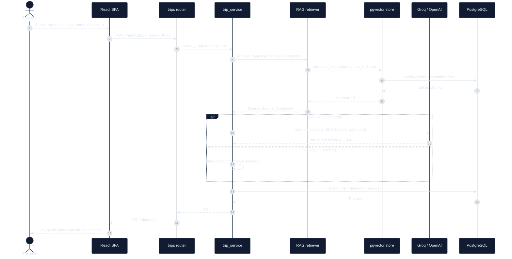
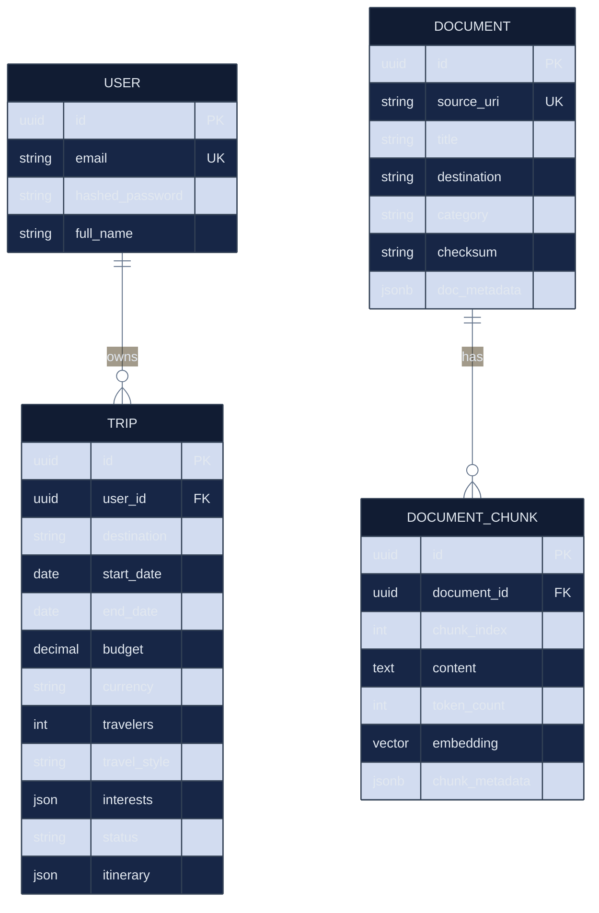
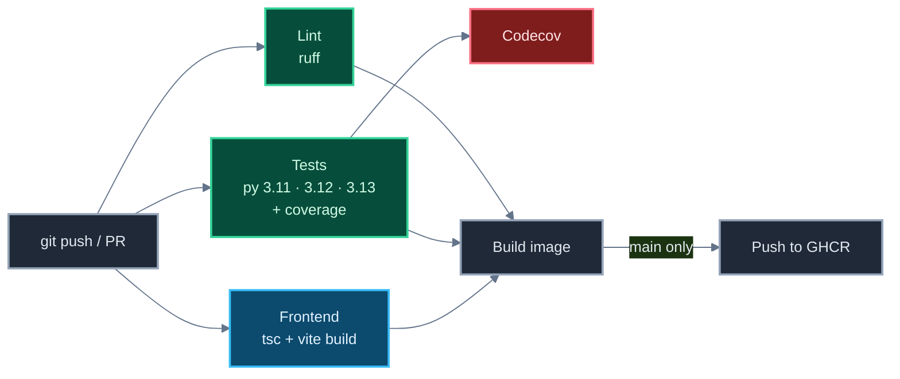

# Architecture

> Visual map of the AI Travel Planner (`tripmind`). Diagrams render natively on
> GitHub (Mermaid). Palette: **sky** = client, **violet** = API surface,
> **emerald** = domain logic, **amber** = RAG, **rose** = data, **slate** = infra.

---

## 1. System Context

```mermaid
%%{init: {"theme":"base","themeVariables":{"background":"#0b1220","primaryColor":"#111c33","primaryTextColor":"#e2e8f0","primaryBorderColor":"#334155","lineColor":"#64748b","fontFamily":"ui-sans-serif, system-ui, -apple-system, Segoe UI, Roboto, sans-serif","fontSize":"15px"}}}%%
flowchart LR
    User([Traveller]):::person

    subgraph CLIENT["Client — React SPA"]
        direction TB
        Vite["Vite + TypeScript<br/>Tailwind CSS"]:::client
        Pages["Pages: Login · Trips · NewTrip · Details"]:::client
        Ctx["Contexts: Auth · Theme · Toast"]:::client
        APIClient["api/client.ts<br/>fetch + JWT + timeout"]:::client
        Vite --> Pages --> Ctx --> APIClient
    end

    subgraph EDGE["API Edge — FastAPI"]
        direction TB
        CORS["CORSMiddleware · /health"]:::api
        V1["/api/v1 router"]:::api
        CORS --> V1
    end

    subgraph CORE["Backend Core"]
        direction TB
        subgraph API["API layer"]
            AuthR["auth<br/>register · login · me"]:::api
            TripR["trips<br/>CRUD · generate"]:::api
            DestR["destinations<br/>search · detail"]:::api
            ChatR["chat<br/>ping (phase 2)"]:::api
        end
        subgraph SVC["Service layer"]
            TripS["trip_service<br/>orchestration"]:::svc
            ItinS["itinerary_service<br/>LLM + fallback"]:::svc
            DestS["destination_service<br/>catalog queries"]:::svc
        end
        subgraph RAG["RAG pipeline"]
            direction TB
            Ing["ingest<br/>md · txt · pdf"]:::rag
            Clean["clean · chunk<br/>overlap 150"]:::rag
            Embed["embeddings<br/>MiniLM → hash fallback"]:::rag
            Store["store<br/>upsert + semantic_search"]:::rag
            Retr["retriever<br/>query + citations"]:::rag
            Ing --> Clean --> Embed --> Store
        end
    end

    subgraph DATA["Data"]
        direction TB
        PG[("PostgreSQL 16<br/>+ pgvector")]:::data
        Models["SQLAlchemy models<br/>User · Trip · Document · Chunk"]:::data
        Alembic["Alembic migrations"]:::data
        Models --> PG
        Alembic -.->|schema| PG
    end

    subgraph EXT["External / Local Models"]
        Groq["Groq · OpenAI<br/>structured JSON"]:::ext
        ST["sentence-transformers<br/>all-MiniLM-L6-v2"]:::ext
    end

    subgraph OPS["Delivery"]
        Docker["Docker / compose"]:::ops
        Actions["GitHub Actions<br/>lint · test · build"]:::ops
        GHCR["GHCR image"]:::ops
        Actions --> GHCR
    end

    User --> CLIENT
    APIClient -->|"HTTPS /api/v1"| CORS
    V1 --> API
    TripR --> TripS
    DestR --> DestS
    AuthR --> Models
    TripS --> Retr
    TripS --> ItinS
    DestS --> Models
    Retr --> Store
    Store --> Models
    ItinS -->|"if key set"| Groq
    ItinS -->|"template fallback"| ItinS
    Embed --> ST
    CORE --> DATA

    classDef person    fill:#1e293b,stroke:#38bdf8,stroke-width:2px,color:#e2e8f0;
    classDef client    fill:#0c4a6e,stroke:#38bdf8,stroke-width:2px,color:#e0f2fe;
    classDef api       fill:#3b0764,stroke:#a78bfa,stroke-width:2px,color:#f3e8ff;
    classDef svc       fill:#064e3b,stroke:#34d399,stroke-width:2px,color:#d1fae5;
    classDef rag       fill:#78350f,stroke:#fbbf24,stroke-width:2px,color:#fef3c7;
    classDef data      fill:#7f1d1d,stroke:#fb7185,stroke-width:2px,color:#ffe4e6;
    classDef ext       fill:#1e1b4b,stroke:#818cf8,stroke-width:2px,color:#e0e7ff;
    classDef ops       fill:#1f2937,stroke:#94a3b8,stroke-width:2px,color:#e2e8f0;

    style CLIENT fill:#0b2540,stroke:#38bdf8,stroke-width:1px,color:#7dd3fc
    style EDGE   fill:#1a0b2e,stroke:#a78bfa,stroke-width:1px,color:#c4b5fd
    style CORE   fill:#022c22,stroke:#34d399,stroke-width:1px,color:#6ee7b7
    style DATA   fill:#2a0a0a,stroke:#fb7185,stroke-width:1px,color:#fda4af
    style EXT    fill:#0b0b2e,stroke:#818cf8,stroke-width:1px,color:#a5b4fc
    style OPS    fill:#0f172a,stroke:#94a3b8,stroke-width:1px,color:#cbd5e1
```

---

## 2. Itinerary Generation — Request Flow

---

## 3. Knowledge Base Ingestion (offline)

```mermaid
%%{init: {"theme":"base","themeVariables":{"background":"#0b1220","primaryColor":"#111c33","primaryTextColor":"#e2e8f0","primaryBorderColor":"#334155","lineColor":"#64748b","fontSize":"14px"}}}%%
flowchart LR
    Files["data/documents<br/>.md · .txt · .pdf"]:::rag
    Clean["cleaning<br/>strip HTML · normalize"]:::rag
    FM["metadata<br/>destination · category<br/>front-matter / path"]:::rag
    Chunk["chunking<br/>size 800 · overlap 150"]:::rag
    Embed["embeddings<br/>SHA256 dedupe"]:::rag
    Upsert["upsert_document<br/>checksum dedupe"]:::rag
    PG[("PostgreSQL<br/>documents + chunks")]:::data

    Files --> Clean --> FM --> Chunk --> Embed --> Upsert --> PG

    classDef rag  fill:#78350f,stroke:#fbbf24,stroke-width:2px,color:#fef3c7;
    classDef data fill:#7f1d1d,stroke:#fb7185,stroke-width:2px,color:#ffe4e6;
```

Run it with `python scripts/ingest_knowledge.py`. Embeddings fall back to a
deterministic hash vector when the model cannot be downloaded, so ingestion and
tests work fully offline.

---

## 4. Data Model

---

## 5. CI/CD Pipeline

